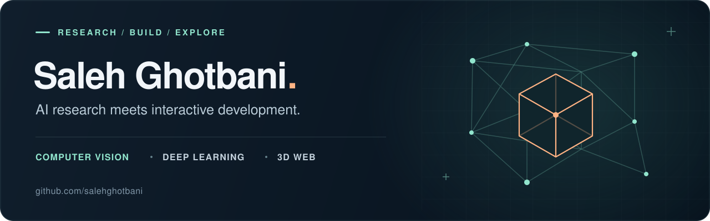
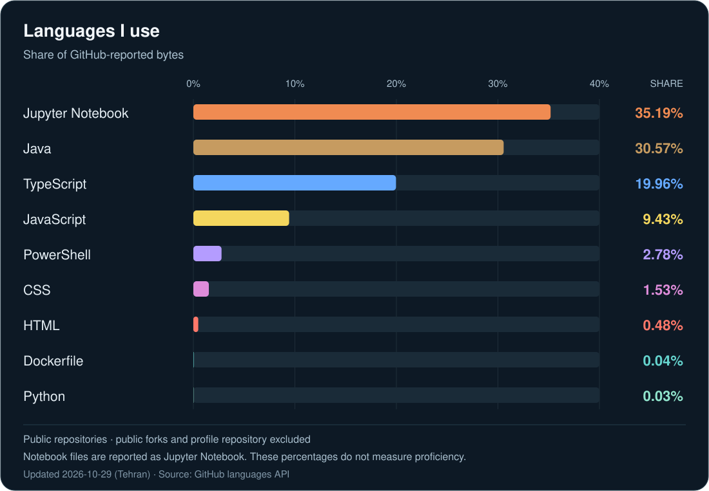
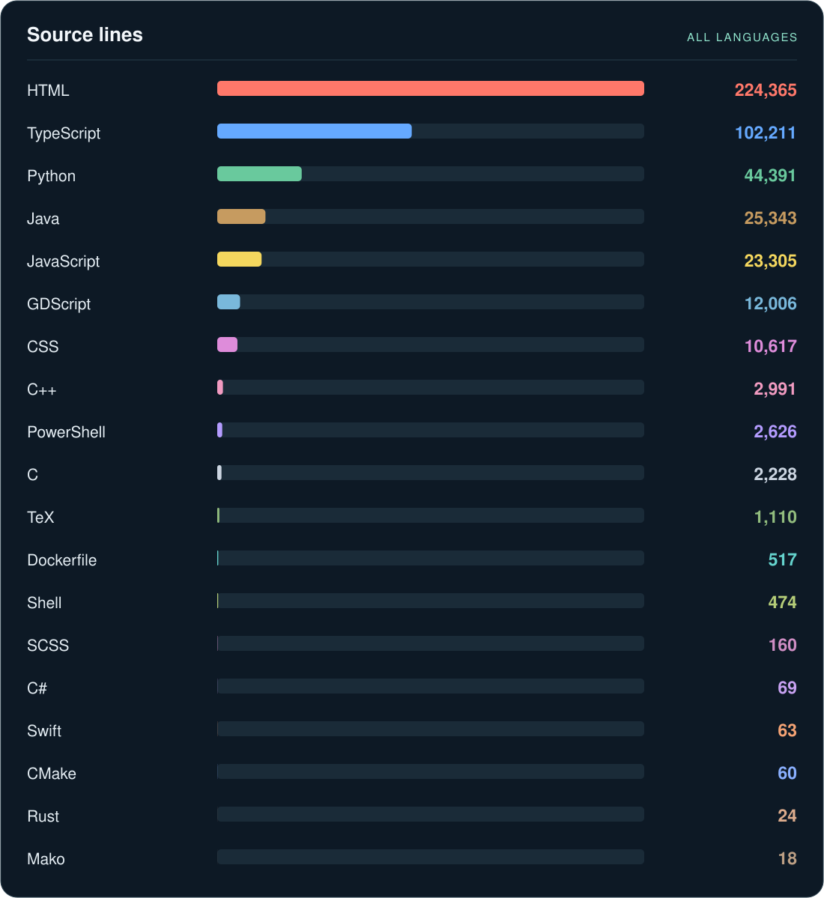

  

  <a href="https://github.com/salehghotbani?tab=repositories">Explore my repositories</a>

## A little about me

I'm **Saleh Ghotbani**, a researcher and web developer working with deep learning, computer vision, and interactive applications.

## Languages I use

  

All languages

  

## Tools I work with

**AI & data** &nbsp; Python · PyTorch · YOLO · Jupyter

**Web** &nbsp; React · TypeScript · Three.js · FastAPI

**Games & applications** &nbsp; Java · JavaScript · Android

---

  <a href="https://github.com/salehghotbani?tab=repositories">More code, experiments, and projects ↗</a>

