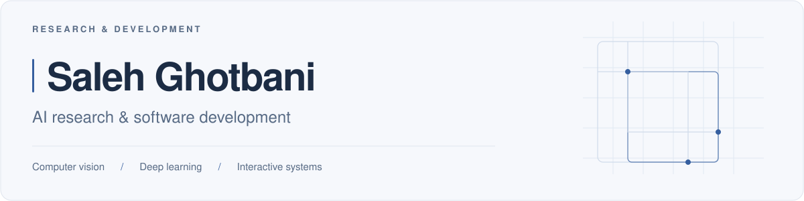
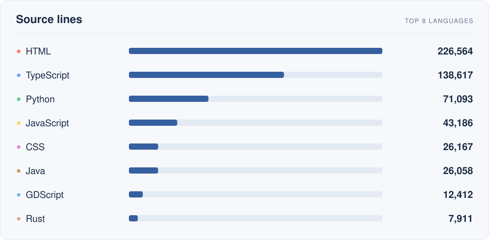
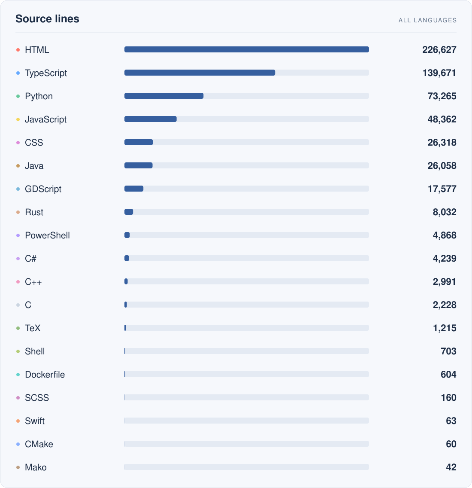

  <picture>
    <source media="(prefers-color-scheme: dark)" srcset="assets/profile-banner.svg" />
    
  </picture>

## About

I'm **Saleh Ghotbani**, a researcher and software developer. My work spans **deep learning**, **computer vision**, and **interactive applications**.

## Code overview

  <picture>
    <source media="(max-width: 600px) and (prefers-color-scheme: dark)" srcset="assets/language-stats-mobile.svg" />
    <source media="(max-width: 600px)" srcset="assets/language-stats-mobile-light.svg" />
    <source media="(prefers-color-scheme: dark)" srcset="assets/language-stats.svg" />
    
  </picture>

View all languages

  <picture>
    <source media="(max-width: 600px) and (prefers-color-scheme: dark)" srcset="assets/language-stats-all-mobile.svg" />
    <source media="(max-width: 600px)" srcset="assets/language-stats-all-mobile-light.svg" />
    <source media="(prefers-color-scheme: dark)" srcset="assets/language-stats-all.svg" />
    
  </picture>

## Technical toolkit

| Area | Technologies |
| :--- | :--- |
| **AI & computer vision** | `Python` · `PyTorch` · `YOLO` · `Jupyter` |
| **Web & interactive systems** | `React` · `TypeScript` · `Three.js` · `FastAPI` |
| **Applications & games** | `Java` · `JavaScript` · `Android` |

---

  <a href="https://github.com/salehghotbani?tab=repositories"><strong>Explore repositories →</strong></a>

